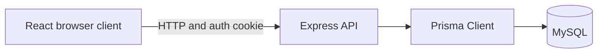
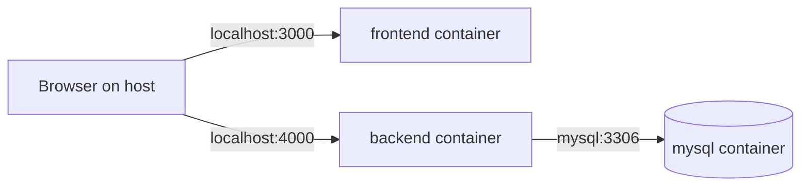

# Habit Shaper Architecture

## System overview

Habit Shaper is a React single-page application backed by an Express JSON API and MySQL. The browser authenticates with a JWT stored in an HttpOnly cookie. Prisma is the application data-access layer.



## Frontend architecture

- `src/app/router.tsx` defines public and protected React Router routes.
- `ProtectedRoute` checks `/api/auth/me` before rendering authenticated pages.
- TanStack Query owns remote server state; feature hooks share query keys across pages.
- React Hook Form and Zod handle forms and client validation.
- `src/services/api.ts` is the shared JSON client and sends `credentials: "include"`.
- Tailwind CSS and local shadcn/ui-based components provide UI primitives.

Implemented routes are `/`, `/login`, `/register`, `/dashboard`, `/habits`, `/habits/:habitId`, and `/goals`; the final four are protected.

## Backend architecture

```text
route -> validation/authentication middleware -> controller -> service
      -> repository -> Prisma -> MySQL
```

Routes compose middleware and handlers. Controllers map HTTP input/output. Services enforce ownership and business rules and shape responses. Repositories contain Prisma queries. Shared middleware validates `body`, `params`, and `query`, validates JWT cookies, and formats errors. Feature modules are `auth`, `habits`, `habit-records`, and `goals`.

## Authentication flow

1. Registration normalizes email, hashes the password with bcrypt (cost 12), and persists only the hash.
2. Login signs a seven-day JWT with the user ID as its subject.
3. The API sets `auth_token`: HttpOnly, `SameSite=Lax`, path `/`, and Secure only in production.
4. Browser requests include credentials. Middleware verifies the cookie and sets `req.user.id`.
5. Services and repositories use this identity for ownership; client `userId` input is not trusted.
6. `GET /api/auth/me` returns the user and `POST /api/auth/logout` clears the cookie.

The JWT is not returned in JSON or stored in localStorage.

## Database interaction

Prisma models map to MySQL tables and repositories scope resource queries by user. The committed migration creates tables, indexes, foreign keys, and enums. Compose runs `npx prisma migrate deploy` before `npm run start`; a migration failure prevents backend startup.

Habit records use an upsert against unique `(habit_id, record_date)`. Streaks and weekly statistics are derived on request rather than stored.

## API structure

- `/api/auth`: registration, login, current user, logout
- `/api/habits`: habit CRUD and filtering
- `/api/habits/:habitId/today`: track today
- `/api/habits/:habitId/records`: history and date filtering
- `/api/habits/:habitId/records/:date`: historical correction
- `/api/habits/:habitId/stats`: type-specific statistics
- `/api/goals`: goal CRUD and filtering

See [API design](api-design.md) for exact contracts.

## Docker architecture



MySQL initializes the configured database/user and exposes a healthcheck. Backend depends on a healthy MySQL service, uses hostname `mysql`, deploys migrations, and exposes port 4000. Frontend builds/runs inside its container on port 3000. Browser code uses host-facing `VITE_API_URL`, normally `http://localhost:4000`, not an internal Docker hostname.

## Error handling

Validation failures return HTTP 400. Expected failures use `AppError`; the final middleware returns:

```json
{
  "error": {
    "code": "VALIDATION_ERROR",
    "message": "Request validation failed",
    "details": { "field": ["Reason"] }
  }
}
```

`details` is optional. Unexpected errors return HTTP 500 with `INTERNAL_SERVER_ERROR` and no internal detail.

## Security assumptions

Implemented controls are bcrypt hashing, signed expiring JWTs in HttpOnly cookies, production Secure cookies, `SameSite=Lax`, credentialed CORS restricted to `FRONTEND_URL`, strict resource schemas, and ownership-scoped queries. Foreign habit/goal IDs produce the same non-leaking 404 as missing resources.

Rate limiting, MFA, OAuth, refresh tokens, and a dedicated CSRF-token mechanism are not implemented.

## Timezone strategy

`APP_TIMEZONE` is the backend calendar-date authority; `.env.example` uses `Asia/Jakarta`.

- Record dates use `YYYY-MM-DD` and MySQL `DATE`, not timestamps.
- “Today” and habit creation dates are derived in `APP_TIMEZONE`.
- Historical writes before creation or after today are rejected.
- Statistics exclude pre-creation and future dates.
- Weeks run Monday through Sunday.
- `created_at` and `updated_at` are MySQL `DATETIME(3)` values serialized as JSON timestamps.
