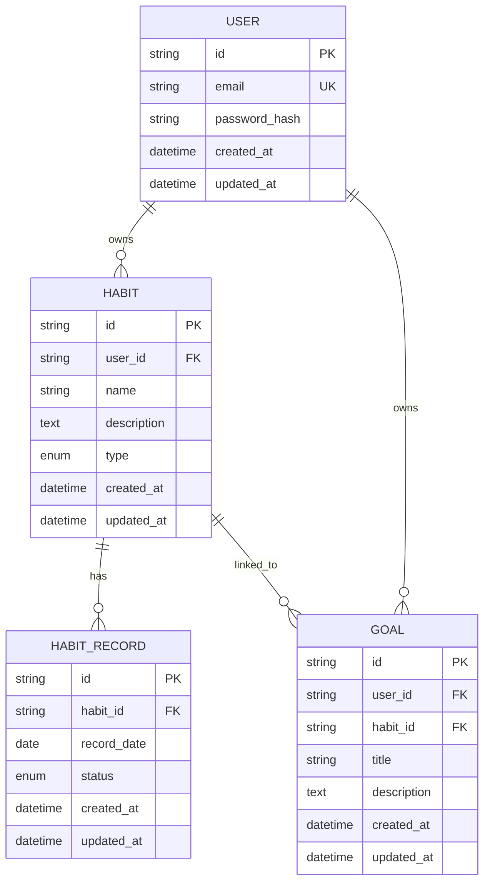

# Habit Shaper Data Model

`backend/prisma/schema.prisma` and the committed migration are the database source of truth.

## Entities and ERD

## Prisma model summary

| Model/table | Required fields | Optional fields | Relationships |
| --- | --- | --- | --- |
| `User` / `users` | UUID `id`, `email`, `passwordHash`, timestamps | None | Owns many habits and goals |
| `Habit` / `habits` | UUID `id`, `userId`, `name`, `type`, timestamps | `description` | Belongs to user; has many records and goals |
| `HabitRecord` / `habit_records` | UUID `id`, `habitId`, `recordDate`, `status`, timestamps | None | Belongs to habit |
| `Goal` / `goals` | UUID `id`, `userId`, `habitId`, `title`, timestamps | `description` | Belongs to user and habit |

`HabitType` is `BUILD | BREAK`. `HabitRecordStatus` is `SUCCESS | FAILURE`. UUID values are generated by Prisma. Descriptions are nullable. MySQL column lengths are email 255, habit name 120, and goal title 160 characters.

## Relationships

- User 1:N Habit through `habits.user_id`.
- User 1:N Goal through `goals.user_id`.
- Habit 1:N HabitRecord through `habit_records.habit_id`.
- Habit 1:N Goal through `goals.habit_id`.

A goal stores both `user_id` and `habit_id`. The service verifies that the linked habit belongs to the authenticated goal owner.

## Database constraints

| Constraint | Database enforcement |
| --- | --- |
| User email uniqueness | Unique index `users_email_key` |
| One record per habit/calendar date | Unique index `habit_records_habit_id_record_date_key` |
| Valid habit type | MySQL enum `BUILD`, `BREAK` |
| Valid record status | MySQL enum `SUCCESS`, `FAILURE` |
| Required IDs, ownership keys, names/titles, dates, timestamps | `NOT NULL` columns |
| Existing relation targets | Foreign keys |

Email normalization, password length, string trimming/length, valid UUID input, historical-date eligibility, goal/habit ownership, and immutable habit type on update are application rules enforced by Zod/services rather than standalone database constraints.

## Indexes

Only the following indexes exist in the Prisma schema/migration:

- `users(email)` — unique
- `habits(user_id)`
- `habits(user_id, type)`
- `habit_records(habit_id, record_date)` — unique
- `goals(user_id)`
- `goals(habit_id)`
- `goals(user_id, habit_id)`

Primary-key indexes exist on every `id`.

## Cascade rules

All declared foreign keys use `ON DELETE CASCADE ON UPDATE CASCADE` in the migration:

- Deleting a user deletes that user's habits and goals.
- Deleting a habit deletes its habit records and linked goals.
- Updating a referenced user or habit ID cascades to dependent rows.

Deleting a user's habits may also delete linked goals through the habit relation; all owned data is removed.

## Source-of-truth decisions

- `HabitRecord` is the source of truth for daily tracking.
- The unique habit/date pair makes a second write a correction through upsert, not another event.
- Streaks and weekly completion are derived from records and are not persisted counters.
- `Habit.createdAt`, interpreted in `APP_TIMEZONE`, establishes the first eligible calendar date.
- `APP_TIMEZONE` is authoritative for “today” and calendar-date comparisons; `record_date` is MySQL `DATE`.
- Goal ownership comes from authenticated `userId`, and a goal may link only to a habit owned by that user.
- Habit type cannot be changed by the update API, although the enum itself is a database constraint.
